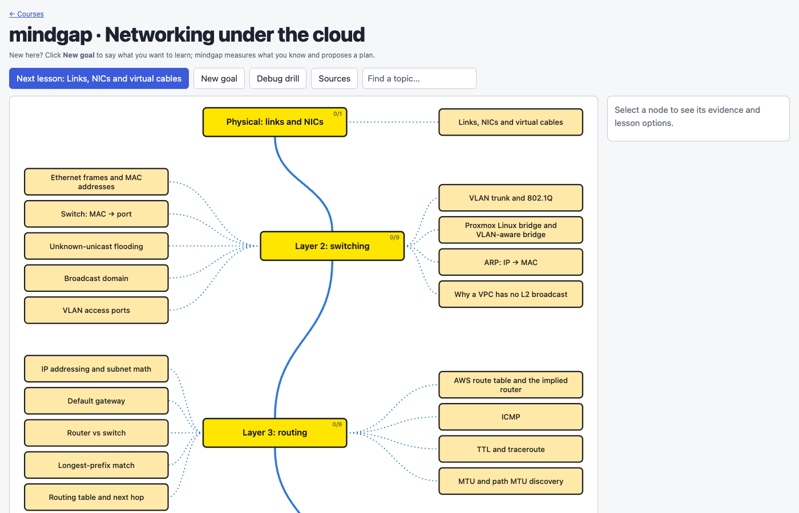

# mindgap

mindgap is a local learning tool for any subject. Courses are made of chapters, labs run real commands in a sandbox, and the tutor runs on the AI CLI subscription you already have.

It ships with a networking course: learn the networking underneath your cloud. It is for engineers who already run VPCs, clusters and hypervisors but never learned the wire underneath. It tests what you actually believe about frames, routes, NAT and overlays. It keeps a map of your gaps and teaches each one from the bytes up, then ties it back to AWS, Kubernetes and Proxmox.

The tutor's teaching method comes from [learnharness](https://github.com/amosblomqvist/learnharness), an agent harness for learning difficult things. See [Credits](#credits-and-license).



## How it works

1. **Map.** 33 topics from L1 to DNS, each with its prerequisites. Every topic starts as `untested`.
2. **Placement check.** The tutor asks prediction questions and marks each topic `gap`, `shaky` or `solid`, with a note recording what you said.
3. **Chapters.** Each topic has a written chapter. Checkpoints ask you to commit to a prediction (with a confidence) before the page reveals the answer. Wrong options are beliefs a smart person could hold, so a miss tells the tutor something.
4. **Labs.** Chapters include commands that run in a real Linux container (`ip`, `tcpdump`, `bridge`, `conntrack`, ...). You predict the output, then run it.
5. **Tutor.** Claude reads your answers in a side drawer, teaches into the gap it finds, and updates the map. You can also run teach, practice and debug-drill sessions from the map.

Each idea is meant to land as something you could have derived, not a fact to memorise: a security group is stateful *because* of conntrack, a pod reaches another node *because* of encapsulation.

## Requirements

- **Node.js 22 or newer.** No npm dependencies.
- **[markitdown](https://github.com/microsoft/markitdown)** (optional): `pip install 'markitdown[all]'`. Only needed to add sources to a course; courses without sources need nothing extra.
- **[Claude Code](https://claude.com/claude-code)** or **agy**, logged in. The server calls the tutor CLI for every turn, on your subscription. Pick with `MINDGAP_TUTOR`.
- **Docker** for the labs: Docker Desktop, OrbStack or Docker Engine. Optional: chapters and the tutor work without it, but lab commands won't run.

## Quickstart

```sh
git clone https://github.com/Tamnme/mindgap.git
cd mindgap
node server.mjs
```

Labs need Docker. The first lab run builds the lab image (a minute or two) and asks for your approval. The image is built once. After a Dockerfile change, run `docker rm -f mindgap-networking` and `docker rmi -f mindgap-networking`; the next lab run rebuilds it.

Open http://localhost:4810 and start with **Placement check**.

On first access to a course, the server copies `courses/<slug>/map.seed.json` to `<data>/courses/<slug>/state/map.json`. Your progress lives in `learner/` and is gitignored.

| Variable | Default | |
|---|---|---|
| `MINDGAP_TUTOR` | `claude` | Tutor CLI: `claude` or `agy`. A lesson stays with the tutor it started with |
| `MINDGAP_MODEL` | `opus` for claude | Model for the tutor (`sonnet` is cheaper and faster) |
| `MINDGAP_EFFORT` | `low` for agy | agy reasoning effort. `medium` reasons more but a teach turn took 168 s of the 180 s limit; agy's own default runs past it |
| `MINDGAP_DATA_DIR` | `learner/` | Where your map, propositions and transcripts live |
| `MARKITDOWN_BIN` | `markitdown` | Converter for course sources (URLs and uploaded files) |
| `PORT` | `4810` | |

## Creating a course

Give a title (and optionally some background about you) to start an empty course; it is created in `<data>/courses/<slug>/`. Open it, optionally add sources, and click **New goal**. When you approve the plan, the tutor draws the course's map: its nodes and layers are added to the course. Nothing is written for the shipped networking course's map. Use **Write chapter** on a node to have the tutor write its chapter on demand. Generated courses have no labs or simulators.

## Upgrading from netbench/underlay

Stop the server, back up `learner/`, then run `node scripts/migrate-learner-v1.mjs` (with `MINDGAP_DATA_DIR` set if your data is elsewhere). It moves your old files into `courses/networking/state/` and converts your map to the current format. Start the server again afterwards.

## Tutors

mindgap calls one tutor CLI for every turn. **Claude Code** and **agy** are supported; both passed `scripts/tutor-gate.mjs` on 2026-10-26. **Codex** is pending: its gate has not been run yet (`node scripts/tutor-gate.mjs codex` once an adapter exists).

## Topics

- **Physical:** Links, NICs and virtual cables
- **Layer 2:** Ethernet frames and MAC addresses · Switch: MAC → port · Unknown-unicast flooding · Broadcast domain · VLAN access ports · VLAN trunk and 802.1Q · ARP: IP → MAC · Proxmox Linux bridge and VLAN-aware bridge · Why a VPC has no L2 broadcast
- **Layer 3:** IP addressing and subnet math · Default gateway · Router vs switch · Longest-prefix match · Routing table and next hop · AWS route table and the implied router · ICMP · TTL and traceroute · MTU and path MTU discovery
- **Layer 4:** UDP · Ports and the 5-tuple · TCP three-way handshake · RST vs silent drop · Stateful vs stateless filtering · Security group vs network ACL · NAT/PAT and conntrack
- **Overlays:** Encapsulation and VXLAN · Kubernetes pod network model · K8s pod network and the Cilium datapath
- **Services:** DHCP · DNS resolution · DNS search domains and ndots · Debug method: work the layers

## Safety

Lab commands run only inside a Docker container, never on your host. The container has no network and no extra Linux capabilities by default. A course that needs more (network access, or capabilities such as `NET_ADMIN`) shows you exactly what it asks for on the first Run; nothing beyond the defaults runs until you approve that request. Commands run only when you click **Run**, with a 30-second timeout and 64 KB of output. The server listens on `127.0.0.1` only. The Claude tutor runs with `--safe-mode` and `--tools ""`, so it has no tools and can't touch your files or your Claude Code config. The agy tutor has no tool-disabling switch that mindgap uses: it is relied on to refuse tool use in headless mode, and `scripts/tutor-gate.mjs` checks that.

## Development

```sh
node --test test/
```

`CONTRACTS.md` defines the shared formats (map, tutor turn schema, HTTP API, chapter files). `docs/CHAPTER_GUIDE.md` explains how to write a chapter.

## Credits and license

mindgap is built on [learnharness](https://github.com/amosblomqvist/learnharness) by [@amosblomqvist](https://github.com/amosblomqvist). The tutor prompts `prompts/teacher.md`, `prompts/practice.md` and `prompts/prober.md` are adapted from it. That includes their teaching method: measure what the learner holds first, establish foundations they can accept as-is, then derive everything else one motivated step at a time. mindgap adds the networking course, chapters, labs, simulator and web workbench around them.

learnharness is licensed AGPL-3.0, and mindgap is released under the same license: see [LICENSE](LICENSE).
